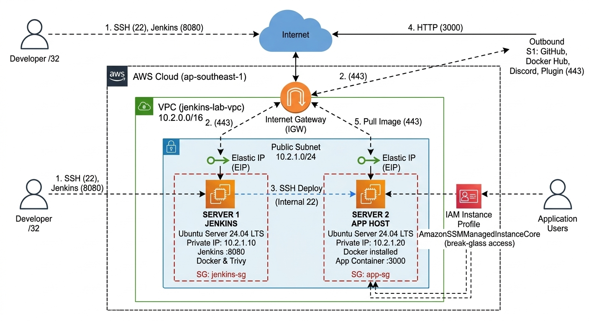
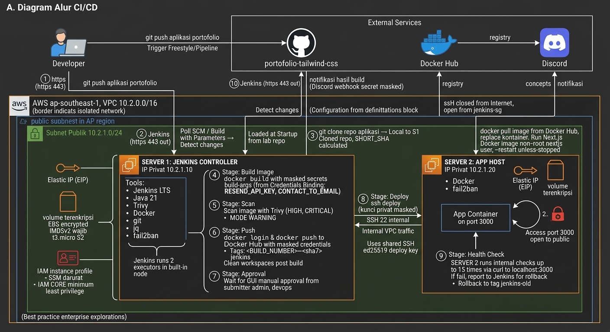

# jenkins-lab-infra

Lab **CI/CD Jenkins self-hosted di AWS** (region `ap-southeast-1`): infrastruktur dibuat dengan **Terraform**, seluruh tools
dipasang otomatis oleh **User Data** saat EC2 dibuat, lalu Jenkins diatur lewat **GUI**. Aplikasi yang di-deploy adalah portofolio
Next.js dari repo [`kanjeeng/portofolio-tailwind-css`](https://github.com/kanjeeng/portofolio-tailwind-css) (hanya di-*clone*, tidak diubah).

## Daftar Isi

1. [Perancangan](#1-perancangan)
2. [Struktur Repositori](#2-struktur-repositori)
3. [Prasyarat](#3-prasyarat)
4. [Persiapan](#4-persiapan)
5. [Membangun Infrastruktur dengan Terraform](#5-membangun-infrastruktur-dengan-terraform)
6. [Setup Jenkins](#6-setup-jenkins)
7. [Pipeline 1: Job Freestyle](#7-pipeline-1-job-freestyle)
8. [Pipeline 2: Job Pipeline (Jenkinsfile)](#8-pipeline-2-job-pipeline-jenkinsfile)
9. [Verifikasi Hasil](#9-verifikasi-hasil)
10. [Clear Infrastruktur (Terraform Destroy)](#10-clear-infrastruktur-terraform-destroy)
11. [Pemecahan Masalah Cepat](#11-pemecahan-masalah-cepat)
12. [Catatan Keamanan](#12-catatan-keamanan)

---

## 1. Perancangan

### 1.1 Tujuan

1. Membangun infrastruktur AWS yang aman dengan Terraform: VPC terisolasi, Security Group *least privilege*, dua EC2,
   IAM *instance profile* minimum, volume terenkripsi, dan IMDSv2 wajib.
2. Memasang Docker, Java 21, Jenkins LTS, dan Trivy secara otomatis lewat User Data.
3. Membuat dua job CI/CD dengan alur **Clone > Build Image > Scan > Push Docker Hub > Deploy ke Server 2**:
   satu **Freestyle** dan satu **Pipeline** berbasis `Jenkinsfile`.
4. Mengeksplorasi fitur Jenkins (plugin, *role binding*, kredensial, integrasi) lewat GUI.

### 1.2 Topologi Infrastruktur



Seluruh lingkungan berada dalam satu VPC `10.2.0.0/16` dengan subnet publik `10.2.1.0/24`.

| Komponen | Server 1: Jenkins | Server 2: App Host |
|---|---|---|
| Fungsi | Menjalankan Jenkins, build image, scan, push, dan deploy | Menjalankan kontainer aplikasi |
| Instans | Ubuntu 24.04, `t3.small` (2 GB RAM), EBS gp3 30 GiB terenkripsi, swap 2 GB | Ubuntu 24.04, `t3.micro`, EBS gp3 20 GiB terenkripsi, swap 2 GB |
| IP | Privat `10.2.1.10` + Elastic IP | Privat `10.2.1.20` + Elastic IP |
| Software (User Data) | Docker, Java 21, Jenkins LTS, Trivy, git, jq, fail2ban | Docker, user `deploy`, fail2ban |
| Port | SSH 22 dan Jenkins 8080, **hanya dari IP pengembang `/32`** | SSH 22 **hanya dari Server 1**, aplikasi 3000 publik |
| Akses darurat | AWS SSM Session Manager | AWS SSM Session Manager |

**Security Group**

| Security Group | Inbound | Outbound |
|---|---|---|
| `jenkins-sg` | TCP 22 dan 8080 dari `developer_ip_cidr` | TCP 443 dan 80 ke internet, TCP 22 ke `app-sg` |
| `app-sg` | TCP 22 dari `jenkins-sg`, TCP 3000 dari internet | TCP 443 dan 80 ke internet |

### 1.3 Alur CI/CD



| No | Pelaku | Aksi | Protokol / Port |
|---|---|---|---|
| 1 | Developer | `git push` ke repo aplikasi | HTTPS 443 |
| 2 | Jenkins | Mendeteksi perubahan (*Poll SCM*) atau dijalankan manual | HTTPS 443 keluar |
| 3 | Jenkins | `git clone` repo aplikasi | HTTPS 443 |
| 4 | Jenkins | `docker build` dengan *build-arg* dari Credentials Binding | Lokal |
| 5 | Jenkins | Scan image dengan Trivy (`HIGH,CRITICAL`) | Lokal |
| 6 | Jenkins | `docker login --password-stdin` dan `docker push` | HTTPS 443 |
| 7 | Admin / DevOps | Persetujuan deploy (job Pipeline) | UI Jenkins |
| 8 | Jenkins | SSH ke Server 2 via IP privat, `docker pull`, ganti kontainer | SSH 22 internal |
| 9 | Jenkins | *Health check* hingga 15 kali, *rollback* bila gagal | HTTP 3000 (lokal di Server 2) |
| 10 | Jenkins | Notifikasi hasil build ke Discord | HTTPS 443 |

### 1.4 Keputusan Rancangan

| Keputusan | Alasan |
|---|---|
| Dua repo: `portofolio-tailwind-css` (aplikasi) dan `jenkins-lab-infra` (lab) | Portofolio tetap bersih, tidak memicu workflow GitHub Actions lama, *state* Terraform terpisah |
| Tanpa Ansible, tools dipasang lewat User Data | Lebih ringan untuk tugas ini. Konsekuensi: User Data hanya berjalan **sekali** saat EC2 dibuat |
| Dua job: Freestyle dan Pipeline | Freestyle memenuhi ketentuan tugas, Pipeline menunjukkan praktik *Pipeline as Code* |
| Freestyle dipicu *Poll SCM*, Pipeline dijalankan manual | *Pipeline script from SCM* memantau repo `jenkins-lab-infra`, bukan repo aplikasi |
| Build berjalan di node bawaan Jenkins | Menyederhanakan lab. Agen terpisah menjadi eksplorasi opsional |
| Jenkins lewat HTTP 8080 yang dibatasi ke satu IP | Sederhana untuk lab. HTTPS (Nginx) menjadi eksplorasi opsional |
| SonarQube, EC2 plugin, Kubernetes plugin tidak dipakai | Berbayar atau butuh infrastruktur tambahan |

### 1.5 Praktik Keamanan yang Diterapkan

| Area | Penerapan |
|---|---|
| Jaringan | VPC terpisah, SG *least privilege*, `developer_ip_cidr` divalidasi Terraform (`/32`, bukan `0.0.0.0/0`) |
| Akses server | Kunci SSH ed25519 buatan lokal (tidak masuk *state*), login password nonaktif, jalur darurat SSM |
| Server 2 | SSH hanya dari `jenkins-sg`. Kunci deploy dibatasi `from="10.2.1.10"` dan tanpa *forwarding* |
| Instans AWS | IMDSv2 wajib, volume terenkripsi, IAM minimum (SSM), tanpa AWS Access Key di server |
| Secret | Hanya di Jenkins Credentials. Env-file runtime dikirim lewat *stdin*. Nilai di-*mask* di log |
| Rantai pasok | Repo APT HTTPS dengan `signed-by`, Trivy sebelum *push*, tag `<BUILD_NUMBER>-<sha7>` |
| Kontainer | `--cap-drop ALL`, `no-new-privileges`, user non-root `nextjs` |

---

## 2. Struktur Repositori

```text
jenkins-lab-infra/
├── Jenkinsfile                          # pipeline berparameter (Pipeline as Code)
├── image/
│   ├── topologi_infrastruktur.jpg       # gambar topologi (dipakai README)
│   └── alur_cicd.jpg                    # gambar alur CI/CD (dipakai README)
├── terraform/jenkins-lab/
│   ├── main.tf  variables.tf  outputs.tf
│   ├── terraform.tfvars.example
│   └── scripts/
│       ├── user-data-jenkins.sh         # tools Server 1
│       └── user-data-app.sh             # tools Server 2
├── jenkins/
│   ├── freestyle-build.sh               # skrip Execute shell job Freestyle
│   └── plugins.txt                      # daftar plugin (referensi)
├── .gitignore
└── README.md
```

---

## 3. Prasyarat

| Kebutuhan | Keterangan |
|---|---|
| Akun AWS | IAM user dengan izin EC2, VPC, IAM, EIP. AWS CLI terkonfigurasi (`aws configure`, region `ap-southeast-1`) |
| Terraform | Versi 1.5.0 atau lebih baru |
| Terminal | Git, OpenSSH (`ssh`, `ssh-keygen`), curl. Disarankan **Git Bash** atau **WSL2** (perintah di bawah memakai sintaks bash) |
| Docker Hub | Username dan *Access Token* (izin Read dan Write) |
| Resend | `RESEND_API_KEY` dan email tujuan formulir kontak |
| Discord | Webhook URL untuk notifikasi build |
| GitHub | Repo aplikasi (sudah ada) dan repo **public** `jenkins-lab-infra` |

Pemeriksaan alat:

```bash
terraform version && aws sts get-caller-identity && ssh -V && git --version
```

---

## 4. Persiapan

### 4.1 Kunci SSH

```bash
mkdir -p ~/.ssh && chmod 700 ~/.ssh

# Kunci admin: laptop ke Server 1 dan Server 2 (beri passphrase)
ssh-keygen -t ed25519 -a 100 -f ~/.ssh/jenkins_lab_admin -C "admin-jenkins-lab"

# Kunci deploy: Jenkins ke Server 2 (tanpa passphrase, privatnya nanti dimasukkan ke Jenkins Credentials)
ssh-keygen -t ed25519 -a 100 -f ~/.ssh/jenkins_lab_deploy -N "" -C "jenkins-deploy"
```

### 4.2 Data yang disiapkan

| Data | Cara memperoleh |
|---|---|
| IP publik pengembang | `curl -s https://checkip.amazonaws.com` |
| Docker Hub token | Docker Hub > Account Settings > Personal access tokens (Read dan Write) |
| Resend API key dan email tujuan | Dasbor Resend |
| Discord webhook | Server Settings > Integrations > Webhooks > New Webhook |
| Kata sandi pengguna Jenkins | Buat sendiri, minimal 16 karakter (`openssl rand -base64 18`) |

### 4.3 Sesuaikan username Docker Hub pada Jenkinsfile

Buka `Jenkinsfile`, cari parameter `DOCKERHUB_NAMESPACE`, lalu ganti `defaultValue: 'kanjeeng'` dengan **username Docker Hub Anda**.

### 4.4 Push ke GitHub

Buat repo kosong **public** `jenkins-lab-infra` di GitHub (Jenkins meng-*clone* `Jenkinsfile` tanpa kredensial), lalu:

```bash
cd jenkins-lab-infra
git init -b main
git add -A
git status          # pastikan tidak ada tfstate, tfvars, tfplan, atau kunci SSH
git commit -m "feat: terraform dan jenkins lab"
git remote add origin https://github.com/<USERNAME-GITHUB>/jenkins-lab-infra.git
git push -u origin main
```

> Bila username GitHub Anda bukan `kanjeeng`, ubah juga URL `jenkins-lab-infra` saat membuat job Pipeline (bagian 8).

---

## 5. Membangun Infrastruktur dengan Terraform

```bash
cd terraform/jenkins-lab
cp terraform.tfvars.example terraform.tfvars
```

Edit `terraform.tfvars`, minimal ganti `developer_ip_cidr` dengan IP publik Anda berakhiran `/32`
(misalnya hasil `curl -s https://checkip.amazonaws.com` + `/32`). Pastikan `admin_public_key_path` dan `deploy_public_key_path`
menunjuk ke kunci publik dari langkah 4.1.

```bash
terraform init
terraform fmt -recursive
terraform validate
terraform plan -out=tfplan      # periksa: 2 EC2, 2 EIP, 2 Security Group, VPC, IAM, key pair
terraform apply tfplan
terraform output                # catat jenkins_url, app_url, dan perintah SSH
```

Tunggu **5 sampai 10 menit** agar User Data selesai di kedua server, lalu periksa:

```bash
# Server 1 (Jenkins)
$(terraform output -raw ssh_jenkins)
cloud-init status --wait          # harus: status: done
sudo systemctl status jenkins --no-pager
docker --version && trivy --version
exit

# Server 2 (App Host) lewat Server 1
$(terraform output -raw ssh_app_via_jenkins)
cloud-init status --wait
docker --version
exit
```

Bila ada yang gagal, baca log: `sudo tail -n 80 /var/log/user-data.log`.

---

## 6. Setup Jenkins

Seluruh langkah berikut dilakukan lewat **GUI Jenkins**. Jenkins hanya dapat dibuka dari IP pengembang.

### 6.1 Buka kunci Jenkins

```bash
# Di Server 1
sudo cat /var/lib/jenkins/secrets/initialAdminPassword
```

1. Buka `jenkins_url` (`http://<jenkins_public_ip>:8080`) di peramban, tempel kata sandi tersebut.
2. Pilih **Install suggested plugins**, tunggu hingga selesai.
3. Buat pengguna admin: ID `admin`, kata sandi kuat, nama lengkap, dan email.
4. Pada **Instance Configuration**, isi **Jenkins URL** dengan `http://<jenkins_public_ip>:8080/`.

### 6.2 Pasang plugin tambahan

Manage Jenkins > **Plugins** > **Available plugins**. Cari, centang, lalu **Install**, kemudian restart Jenkins:

| Kategori | Plugin |
|---|---|
| Pipeline | Pipeline: Stage View, Pipeline Graph View, Timestamper, Build Timeout, Workspace Cleanup |
| Source code | GitHub |
| Kontainer dan deploy | Docker Pipeline, SSH Agent |
| Keamanan | Credentials Binding, Role-based Authorization Strategy, Folders |
| Notifikasi | Discord Notifier |

Daftar lengkap plugin (termasuk eksplorasi) ada di `jenkins/plugins.txt`.

### 6.3 Rekam host key Server 2

Stage Deploy memakai `StrictHostKeyChecking=yes`, sehingga *host key* Server 2 harus dikenali user `jenkins` lebih dulu:

```bash
# Di Server 1
sudo /usr/local/bin/register-app-hostkey
```

Pembanding (jalankan di Server 2, sidik jarinya harus sama dengan yang ditampilkan skrip):

```bash
ssh-keygen -lf /etc/ssh/ssh_host_ed25519_key.pub
```

### 6.4 Folder dan kredensial

1. Buat **New Item** > **Folder** bernama `portofolio` (semua job dibuat di dalam folder ini).
2. Manage Jenkins > **Credentials** > **System** > **Global credentials** > **Add Credentials**. **ID harus persis sama**:

| ID | Kind | Isi |
|---|---|---|
| `dockerhub-credentials` | Username with password | Username Docker Hub dan Access Token |
| `ssh-deploy-key` | SSH Username with private key | Username `deploy`, *Enter directly*: isi `cat ~/.ssh/jenkins_lab_deploy` (kunci **privat** deploy) |
| `resend-api-key` | Secret text | `RESEND_API_KEY` |
| `contact-to-email` | Secret text | `CONTACT_TO_EMAIL` |
| `discord-webhook` | Secret text | URL webhook Discord |

### 6.5 (Opsional) Pengguna dan role binding

Manage Jenkins > **Security**: *Security Realm* = Jenkins' own user database, **nonaktifkan** sign-up. Buat pengguna `devops`,
`developer`, `viewer`. Lalu **Authorization** = *Role-Based Strategy* dan atur lewat **Manage and Assign Roles**:

| Role | Permission | Pengguna |
|---|---|---|
| `admin` (global) | Overall: Administer | `admin` |
| `authenticated-read` (global) | Overall: Read, View: Read | `devops`, `developer`, `viewer` |
| `devops-portofolio` (item, pola `portofolio.*`) | Job: Build, Cancel, Configure, Create, Delete, Discover, Read, Workspace. Run: Delete, Replay, Update | `devops` |
| `developer-portofolio` (item) | Job: Build, Cancel, Discover, Read, Workspace | `developer` |
| `viewer-portofolio` (item) | Job: Discover, Read | `viewer` |

Urutan penting: buat role dan tetapkan `admin` **sebelum** mengganti strategi otorisasi agar tidak terkunci.

Jenkins siap dipakai bila: login berhasil, plugin terpasang, folder `portofolio` ada, dan kelima kredensial tersimpan.

---

## 7. Pipeline 1: Job Freestyle

Job ini dipicu otomatis (*Poll SCM*) setiap ada commit baru pada repo aplikasi.

1. Di folder `portofolio`: **New Item** > nama `portofolio-freestyle` > **Freestyle project** > OK.
2. Isi konfigurasi:

| Bagian | Isian |
|---|---|
| General | *Discard old builds* maksimal 20 build |
| Source Code Management | Git, URL `https://github.com/kanjeeng/portofolio-tailwind-css.git`, branch `*/main`. *Additional Behaviours*: **Clean before checkout** |
| Build Triggers | **Poll SCM**, jadwal `H/5 * * * *` |
| Build Environment | Centang *Add timestamps to the Console Output*. Centang *Abort the build if it's stuck* (absolute 30 menit, *Fail the build*). Centang **SSH Agent**, pilih kredensial `ssh-deploy-key`. Centang **Use secret text(s) or file(s)** lalu tambahkan: *Username and password (separated)* dengan Username Variable `DOCKERHUB_USER`, Password Variable `DOCKERHUB_PASS`, Credentials `dockerhub-credentials`. Tiga *Secret text*: `RESEND_API_KEY` (kredensial `resend-api-key`), `CONTACT_TO_EMAIL` (`contact-to-email`), `DISCORD_WEBHOOK` (`discord-webhook`) |
| Build Steps | **Add build step** > **Execute shell**, tempel seluruh isi `jenkins/freestyle-build.sh` |

3. **Save**, lalu klik **Build Now**.
4. Buka build tersebut > **Console Output**. Urutan yang harus selesai tanpa galat: build image, scan Trivy, push ke Docker Hub, kirim env-file, deploy di Server 2, health check, notifikasi Discord.

Hasil: aplikasi tampil di `http://<app_public_ip>:3000`. Image `<username-dockerhub>/portofolio-jenkins` berisi tag `<BUILD_NUMBER>-<sha7>` dan `freestyle`.

---

## 8. Pipeline 2: Job Pipeline (Jenkinsfile)

Job ini memakai `Jenkinsfile` dari repo `jenkins-lab-infra` dan dijalankan manual lewat **Build with Parameters**.

1. Di folder `portofolio`: **New Item** > nama `portofolio-pipeline` > **Pipeline** > OK.
2. Pada bagian **Pipeline**:

| Isian | Nilai |
|---|---|
| Definition | **Pipeline script from SCM** |
| SCM | Git |
| Repository URL | `https://github.com/<USERNAME-GITHUB>/jenkins-lab-infra.git` |
| Branch Specifier | `*/main` |
| Script Path | `Jenkinsfile` |
| Lightweight checkout | Aktif |

3. **Save**, lalu klik **Build Now** sekali agar parameter terdaftar (build pertama memakai nilai bawaan dan akan berhenti pada Approval; boleh di-*abort* atau disetujui).
4. Klik **Build with Parameters**. Pastikan `DOCKERHUB_NAMESPACE` berisi username Docker Hub Anda, lalu **Build**.

| Parameter | Bawaan | Fungsi |
|---|---|---|
| `GIT_URL`, `GIT_BRANCH` | repo aplikasi, `main` | Sumber kode yang di-build |
| `DOCKERHUB_NAMESPACE`, `IMAGE_NAME` | username Anda, `portofolio-jenkins` | Nama image tujuan |
| `CONTAINER_NAME`, `HOST_PORT` | `portofolio`, `3000` | Pengaturan kontainer di Server 2 |
| `APP_SERVER_HOST` | `10.2.1.20` | Harus di subnet `10.2.1.0/24` |
| `ACTION`, `IMAGE_TAG` | `build-and-deploy` | `deploy-existing-tag` + `IMAGE_TAG` untuk rollback manual |
| `REQUIRE_APPROVAL` | `true` | Meminta persetujuan sebelum deploy |
| `TRIVY_FAIL_ON_VULN` | `false` | Bila `true`, kerentanan HIGH/CRITICAL menggagalkan build |
| `LINT_STRICT` | `false` | Bila `false`, kegagalan lint hanya menandai UNSTABLE |

5. Pantau di **Pipeline Graph View**. Stage 1 sampai 5 berjalan (Checkout, Install and Lint, Build Image, Scan Image, Push to Docker Hub), lalu berhenti pada **6. Approval**.
6. Klik **Proceed** (login `admin` atau `devops`). Stage 7 (Deploy) dan 8 (Health Check) berjalan.
7. Hasil: aplikasi tampil di `http://<app_public_ip>:3000`, artefak `trivy-report.json` tersedia, dan Discord menerima status `SUCCESS`.

**Rollback manual:** jalankan **Build with Parameters** dengan `ACTION = deploy-existing-tag` dan `IMAGE_TAG` berisi tag sebelumnya (contoh `12-a1b2c3d`). Tahap build dilewati, persetujuan tetap diminta, lalu image lama dideploy ulang.

Alur stage:

| Stage | Aksi |
|---|---|
| Prepare | Validasi parameter dengan *regex* |
| 1. Checkout | Clone repo aplikasi, hitung `SHORT_SHA` dan tag build |
| 2. Install and Lint | `npm ci` dan `npm run lint` di kontainer `node:20-alpine` |
| 3. Build Image | `docker build` dengan *build-arg* dari Credentials Binding |
| 4. Scan Image | Trivy `HIGH,CRITICAL` |
| 5. Push to Docker Hub | `docker login --password-stdin` lalu `docker push` |
| 6. Approval | `input` oleh `admin` atau `devops` |
| 7. Deploy | SSH ke Server 2, env-file via *stdin*, ganti kontainer |
| 8. Health Check | `curl` hingga 15 kali, *rollback* otomatis bila gagal |
| Post | `cleanWs()`, `docker image prune`, notifikasi Discord |

---

## 9. Verifikasi Hasil

```bash
curl -I http://<app_public_ip>:3000                     # harus HTTP 200
```

- Buka `http://<app_public_ip>:3000/contact`, kirim pesan uji. Email harus masuk ke alamat `CONTACT_TO_EMAIL`.
- Di **Console Output** build, cari `RESEND_API_KEY`. Nilainya harus tampil `****` (di-*mask*).
- Di Server 2: `docker ps --filter name=portofolio` harus menampilkan kontainer berstatus *Up*.
- SSH langsung ke Server 2 dari internet harus **timeout** (port 22 hanya dari Server 1).

---

## 10. Clear Infrastruktur (Terraform Destroy)

Hapus seluruh infrastruktur setelah selesai agar tidak ada biaya tersisa (EC2, Elastic IP, dan EBS dikenai biaya).

```bash
cd terraform/jenkins-lab
terraform destroy              # ketik: yes
```

Pastikan tidak ada sisa:

```bash
aws ec2 describe-addresses --region ap-southeast-1 --query 'Addresses[].PublicIp'                    # harus kosong
aws ec2 describe-instances --region ap-southeast-1 --query 'Reservations[].Instances[].State.Name'  # terminated
aws ec2 describe-volumes   --region ap-southeast-1 --query 'Volumes[].VolumeId'                      # harus kosong
```

Setelah itu:

- *Revoke* token Docker Hub dan hapus webhook Discord yang dipakai untuk lab.
- Bila pernah menambah aturan Security Group sementara (webhook atau SMTP), pastikan sudah dihapus (otomatis hilang bersama `destroy`).
- Aktifkan **AWS Budgets** dengan batas rendah bila akan melanjutkan lab berikutnya.

---

## 11. Pemecahan Masalah Cepat

| Gejala | Penyebab umum | Penanganan |
|---|---|---|
| `terraform validate` gagal pada `developer_ip_cidr` | Bukan `/32` atau `0.0.0.0/0` | Isi satu IP dengan akhiran `/32` |
| Tidak bisa membuka Jenkins | IP pengembang berubah | Ubah `developer_ip_cidr`, `terraform apply` ulang |
| Jenkins belum aktif | User Data belum selesai | `cloud-init status --wait`, baca `/var/log/user-data.log` |
| *Host key verification failed* saat deploy | `known_hosts` Server 2 belum direkam | Jalankan `sudo /usr/local/bin/register-app-hostkey` di Server 1 |
| `docker: permission denied` pada build | User `jenkins` belum masuk grup docker | `sudo usermod -aG docker jenkins && sudo systemctl restart jenkins` |
| Build Next.js dibunuh (*Killed*) | RAM `t3.small` habis | Ganti `jenkins_instance_type` ke `t3.medium`, `terraform apply` |
| Push ditolak Docker Hub | `DOCKERHUB_NAMESPACE` berbeda dari username token | Samakan parameter dengan username Docker Hub |
| Terkunci setelah mengganti otorisasi | Role belum ditetapkan ke `admin` | Hentikan Jenkins, ubah `<useSecurity>` di `/var/lib/jenkins/config.xml` menjadi `false`, nyalakan lagi |
| Aplikasi tidak terbuka di :3000 | Health check gagal | Lihat log job, `docker logs portofolio` di Server 2 |

Jalur darurat bila SSH bermasalah: `terraform output ssm_jenkins` atau `ssm_app`.

---

## 12. Catatan Keamanan

- Jangan *commit*: `terraform.tfvars`, `*.tfstate*`, `tfplan`, kunci SSH. `.gitignore` sudah memblokirnya.
- Rahasia (token Docker Hub, webhook Discord, API key) hanya diketik ke Jenkins Credentials.
- Anggota grup `docker` setara *root* pada host. Risikonya dikurangi dengan SG yang ketat dan pembatasan `from=` pada kunci deploy.
- Jenkins berjalan pada HTTP 8080 yang dibatasi ke satu IP. Untuk penggunaan lebih serius, tambahkan HTTPS (Nginx) atau akses lewat VPN.
- User Data hanya berjalan sekali. Bila skrip diubah, buat ulang EC2 dengan `terraform apply -replace=aws_instance.jenkins` (atau `.app`).